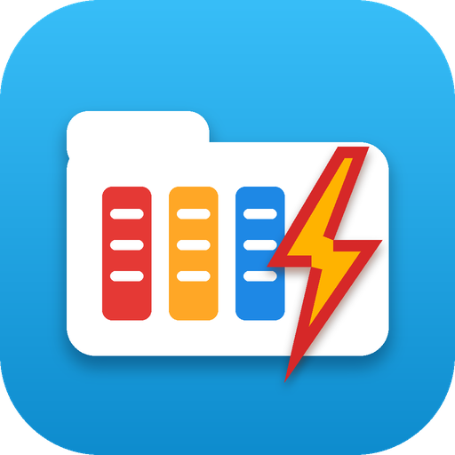
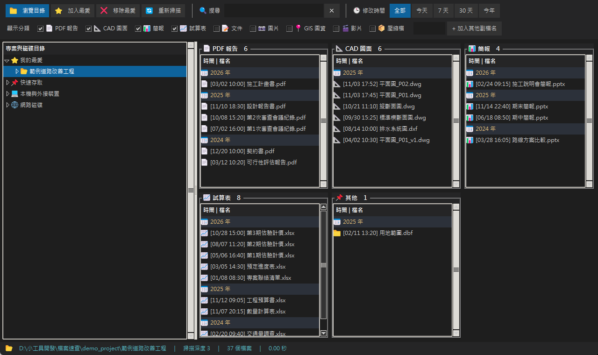

<div align="center">



# WingLightFinder — 專案檔案速查

**不知道檔名，也能一眼找到「這個案子最近動過哪些圖、報告和簡報」**

[](LICENSE)
[](#)
[](#)
[](../../actions)

</div>



<sub>畫面中是程式產生的範例資料夾（`tools/make_demo_folder.py`），不是真實案件。</sub>

## 為什麼做這個

工程專案的資料夾通常有好幾層：規劃、設計、審查意見、施工、估驗……要找「上個月改的那張平面圖」或「最新的簡報」，在檔案總管裡得一層一層點進去，或是記得檔名才搜得到。

WingLightFinder 把一個專案資料夾往下掃 2~3 層，**依軟體類型分欄、新的排在最上面、中間用年份隔開**，打開就看得到整個案子最近的動態。

## 功能

| 功能 | 說明 |
| :--- | :--- |
| 🗂️ 分頁 | 像瀏覽器一樣開好幾個資料夾來回切換（Ctrl+T 新分頁、Ctrl+W 關閉、Ctrl+Tab 切換；在左邊資料夾上按中鍵或右鍵「在新分頁開啟」），可以拖曳調整順序。每個分頁各自記住搜尋字和時間篩選 |
| 📌 釘選分頁 | 常用的資料夾釘在最左邊，每次開啟都會打開；不想還原其他分頁時，取消右上角「記住上次畫面」即可 |
| 🔄 自動更新 | 切換分頁、從別的程式切回來時在背景重掃，開著不動時每 30 秒檢查一次；新存的檔案不必手動重新掃描就會出現 |
| 📂 依類型分欄 | PDF、CAD 圖面、簡報、試算表各一欄（文件、圖片、GIS 圖資、影片、壓縮檔、其他可自行勾選），也能加入自訂副檔名 |
| 🕒 新到舊＋年份分隔 | 每欄依修改時間排序，跨年份時插入分隔列 |
| 🔍 關鍵字搜尋 | 輸入「審查 紀錄」這類多個關鍵字，會同時比對子資料夾和檔名，所有欄位即時過濾 |
| 📅 時間快篩 | 今天／7 天／30 天／今年 |
| ⚡ 背景掃描 | 掃描不會卡住視窗；切換分類、搜尋都不必重讀硬碟，掃過的資料夾先顯示上次的結果再在背景更新（F5 從頭重新掃描） |
| 🧭 看得出在哪個子資料夾 | 滑鼠停在檔名上會顯示「子資料夾\檔名」，點一下在下方顯示大小和修改時間 |
| 📋 右鍵選單 | 開啟、開啟檔案位置、複製檔案（Ctrl+C，可以直接貼到檔案總管或 LINE）、複製完整路徑、複製檔名；PDF 可直接[用 WingLightPDF 開啟](https://github.com/Human-chang/WingLightPDF) |
| ⭐ 我的最愛 | 常用專案資料夾一鍵切換；網路磁碟也可以。在左邊資料夾上按右鍵就能加入或移除 |
| 🌗 淺色、深色主題 | 第一次開啟跟著 Windows 的設定，左下角可以切換，選了之後會記住 |
| 🧹 自動略過雜檔 | Office 開啟中的 `~$` 鎖定檔、AutoCAD 的 `.dwl`、Shapefile 和影像的附屬檔不會塞滿「其他」欄 |

### 掃描深度

為了不把整顆硬碟掃一遍，深度依資料夾位置自動決定：

- 磁碟根目錄（例如 `D:\`）：只列根目錄的檔案
- 第二層（例如 `D:\計畫案`）：往下 2 層
- 更深的資料夾：往下 3 層

讀不到的資料夾（網路磁碟斷線、沒有權限、路徑太長）會在下方狀態列提醒，點一下可以看清單。

## 下載與使用

1. 到右側 **[Releases](../../releases)** 下載 `WingLightFinder-版本.zip`，解壓縮到任意位置。
2. 雙擊 **`WingLightFinder.exe`**。不需要安裝，也不需要系統管理員權限。
3. 第一次開啟時，Windows 可能跳出「Windows 已保護您的電腦」：這是因為程式沒有付費的數位簽章，按「**其他資訊 → 仍要執行**」即可。執行檔是 GitHub Actions 從公開原始碼自動打包的，打包紀錄都在 [Actions](../../actions) 頁面。

設定（我的最愛、釘選的分頁、勾選的分類、視窗大小、深淺色）存在程式旁邊的 `WingLightFinder.json`，整個資料夾搬到別台電腦設定也會跟著走。

> 用過舊版「專案檔案速查儀表板」的話，把舊的 `explorer_config.json` 放進同一個資料夾，第一次開啟會自動匯入我的最愛。

## 從原始碼執行

只用 Python 內建的套件（tkinter），不需要安裝任何東西：

```bash
git clone https://github.com/Human-chang/WingLightFinder.git
cd WingLightFinder
python main.py                 # 啟動
python main.py "D:\計畫案"      # 啟動並直接開啟資料夾
python -m unittest discover -s tests   # 單元測試
python main.py --self-test     # 自我測試（不顯示視窗）
```

打包綠色免安裝版：執行 `打包綠色免安裝版.bat`。它會建立專用的 `.venv`、跑單元測試、依 `WingLightFinder.spec` 用資料夾模式打包，再對成品跑一次自我測試。

---

## English

**WingLightFinder** is a portable, offline Windows tool for engineers who live in deep project folders. Point it at a project and it scans 2–3 levels down, then shows files **in columns by type (PDF, CAD, slides, spreadsheets …), newest first, with year separators** — so you can see what changed recently without knowing any file names.

- Browser-style tabs to switch between project folders (Ctrl+T / Ctrl+W / Ctrl+Tab); each tab keeps its own search and time filter, and tabs are restored on next launch
- Multi-keyword search across sub-folder and file names, time filters (today / 7 days / 30 days / this year)
- Background scanning with per-folder cache; toggling columns or searching never re-reads the disk
- Hover to see the sub-folder, right-click (or Ctrl+C) to copy the file itself, copy paths or open the file location
- Favorites (network drives included), custom extensions, settings stored next to the app
- Light and dark themes; follows Windows on first launch
- Pure Python standard library (tkinter); released builds are produced by GitHub Actions from this source

Download the zip from **[Releases](../../releases)**, extract it anywhere and run `WingLightFinder.exe`.

## License

[MIT](LICENSE) © 2026 [Human-chang](https://github.com/Human-chang)
